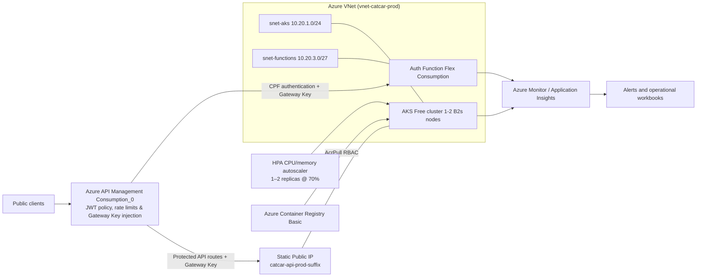

# CatCar - Kubernetes & Platform Infrastructure (`catcar-kubernetes-infra`)

Terraform Infrastructure as Code (IaC) repository provisioning core networking, container orchestration (AKS), container registry (ACR), API Gateway (APIM), and Azure Monitor observability alerting for the CatCar platform under the **academic cloud consolidation model**.

---

## Provisioned Infrastructure

- **Networking**: Azure Virtual Network (`vnet-catcar-prod`) with subnets for AKS (`snet-aks`, `10.20.1.0/24`) and Azure Functions (`snet-functions`, `10.20.3.0/27`).
- **Container Orchestration**: Azure Kubernetes Service (AKS `aks-catcar-prod`) with SKU Tier `Free`, 1–2 `Standard_B2s` nodes, Azure CNI with Cilium, Workload Identity, Microsoft Entra RBAC, and Container Insights.
- **Container Registry**: Azure Container Registry Basic (`catcarprod<sub_suffix>`) configured with automated RBAC `AcrPull` bindings to AKS kubelet identity and `AcrPush` bindings to deploy identity.
- **API Gateway**: Azure API Management (`apim-catcar-prod-<sub_suffix>`) with SKU `Consumption_0`, custom XML policies (`apim-policy.xml`), `X-CatCar-Gateway-Key` injection, and `rate-limit` policies routing public traffic to the AKS public IP FQDN backend and serverless Auth Function.
- **Public IP**: Dedicated static Public IP (`pip-catcar-prod-api`) with DNS label (`catcar-api-prod-<sub_suffix>`) for AKS API LoadBalancer.
- **Student Budget**: Subscription consumption budget (`catcar-student-budget`) aligned to credit expiration (`2028-08-31`) with action group notifications at 50%, 75%, 90%, 100% actual and 90% forecast.
- **Observability & Alerting (`alerts/`)**: Log Analytics Workspace (`law-catcar-prod`), Application Insights (`appi-catcar-prod`), Action Groups, Scheduled Query Alert rules, Metric Alerts, and synthetic readiness uptime probes.

---

## Dedicated Network & Kubernetes Architecture



---

## APIM Routing & Ingress Policy

APIM is the public routing boundary: it applies the JWT policy, injects `X-CatCar-Gateway-Key`, routes `POST /api/auth/customer` to the serverless authentication backend, and routes protected platform APIs to AKS.

- **Platform Scalar API Reference:** [http://localhost:5000/docs](http://localhost:5000/docs)
- **Versioned Postman collection:** [`CatCar_Platform.postman_collection.json`](https://github.com/RiseOn-CatCar/catcar-platform/blob/main/docs/postman/CatCar_Platform.postman_collection.json)
- **Postman environment template:** [`CatCar_Platform.postman_environment.json`](https://github.com/RiseOn-CatCar/catcar-platform/blob/main/docs/postman/CatCar_Platform.postman_environment.json)

---

## Repository Structure

```
.
├── main.tf                    # Core network, AKS, ACR, APIM, and Public IP resources
├── variables.tf               # Input parameters and defaults
├── outputs.tf                 # Cluster, public IP, and gateway outputs
├── apim-policy.xml            # API Management routing and JWT validation policy
├── alerts/
│   └── catcar-alerts.tf       # Metric alerts, action groups, query rules, web tests
├── scripts/
│   └── bootstrap-azure.sh     # Script to provision Azure control-plane and GitHub OIDC
├── docs/
│   └── azure-bootstrap.md     # Step-by-step setup documentation
└── .github/workflows/ci-cd.yml # Automated lint, validation, and production tag apply
```

---

## Local Validation

```bash
# Validate core infrastructure
terraform init -backend=false
terraform fmt -check -recursive
terraform validate

# Validate alerts infrastructure
cd alerts
terraform init -backend=false
terraform fmt -check -recursive
terraform validate
```

---

## CI/CD Pipeline

- **Pull Requests / Pushes to `main`**: Runs `terraform fmt` and `terraform validate` on both core and alerts modules.
- **Production Tag Push (`v*.*.*`)**: Applies changes to **Production** environment (`catcar-prod`) with state keys `catcar-kubernetes.tfstate` and `catcar-alerts.tfstate`.
