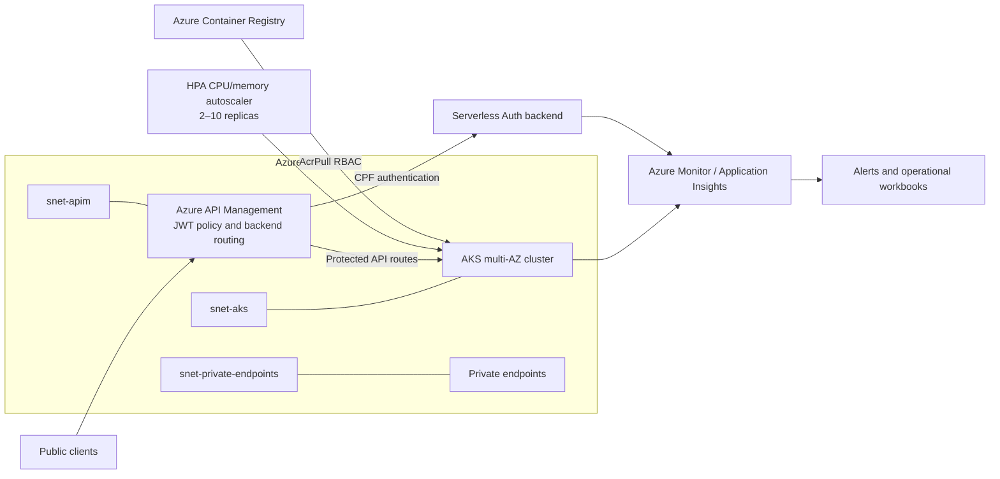

# CatCar - Kubernetes & Platform Infrastructure (`catcar-kubernetes-infra`)

Terraform Infrastructure as Code (IaC) repository provisioning core networking, container orchestration (AKS), container registry (ACR), API Gateway (APIM), and Azure Monitor observability alerting for the CatCar platform.

---

## Provisioned Infrastructure

- **Networking**: Azure Virtual Network (`vnet-catcar`) with subnets for AKS (`snet-aks`), API Management (`snet-apim`), and Private Endpoints (`snet-private-endpoints`).
- **Container Orchestration**: Azure Kubernetes Service (AKS) with Azure CNI, Workload Identity, Microsoft Entra RBAC, and Container Insights.
- **Container Registry**: Azure Container Registry (ACR) configured with automated RBAC `AcrPull` bindings to AKS kubelet identity.
- **API Gateway**: Azure API Management (APIM) with custom XML policies (`apim-policy.xml`) routing public traffic to AKS backend and serverless Auth Function.
- **Observability & Alerting (`alerts/`)**: Log Analytics Workspace, Application Insights, Action Groups, Scheduled Query Alert rules, Metric Alerts (CPU, Memory, Latency > 2s), and synthetic readiness uptime probes.

The foundation also provisions a private Container Apps environment and DNS for the customer authentication workload, private DNS for the AKS API load balancer, and an Azure-managed Communication Services email domain. The Function itself belongs to the auth infrastructure state. ACR permits authenticated public access for hosted CI runners; admin credentials remain disabled and private endpoints remain available.

Before applying, inspect the existing foundation state and Azure resources and import any existing equivalent resources rather than creating duplicates. Confirm the auth subnet does not overlap existing subnets and choose a free `auth_function_subnet_prefix`; the default follows this root's existing `10.20.0.0/16` defaults and is not evidence of availability. Confirm `api_private_ip` is free in the AKS subnet; its derived default must not be used without that check. Set name override inputs for existing VNet, AKS, ACR, workspace or auth app names that differ from the derived names. Import any existing equivalent AKS Network Contributor role assignment before applying.

The API backend uses `catcar-api.catcar.internal`; its private DNS record must match the internal AKS Service address. APIM's `catcar-work-order-mutations-paused` named value blocks mutations under `/api/v1` except the exact admin login route. Set it to `true` before draining; keep it enabled on failure, and release it only after reconciliation and health checks. Terraform deliberately ignores subsequent changes to this value, so foundation refresh and apply preserve an active pause.

The platform's `azure` GitHub environment supplies `AZURE_TF_STATE_RG`, `AZURE_TF_STATE_STORAGE_ACCOUNT`, and `TF_BACKEND_CONTAINER`. Verify backend coordinates and resource identities before deploying. Terraform state contains secrets and must not be published. Communication connection string is a sensitive output. The release derives the alert `health_probe_url` from the APIM gateway URL plus `/api/health/ready`.

## Dedicated Network & Kubernetes Architecture



Terraform establishes the network boundaries and Kubernetes control plane: a multi-availability-zone AKS cluster in `snet-aks`, APIM in `snet-apim`, private service connectivity in `snet-private-endpoints`, workload autoscaling from 2 to 10 replicas, ACR image pulls through RBAC, and centralized telemetry, alerts, and workbooks.

## APIM Routing & Postman Integration

APIM is the public routing boundary: it applies the JWT policy, routes `POST /api/auth/customer` to the serverless authentication backend, and routes protected platform APIs to AKS.

- **Swagger UI through the platform API:** [http://localhost:5000/swagger](http://localhost:5000/swagger)
- **Scalar API Reference:** [http://localhost:5000/docs](http://localhost:5000/docs)
- **OpenAPI v3 JSON:** [http://localhost:5000/openapi/v1.json](http://localhost:5000/openapi/v1.json)
- **Versioned Postman collection:** [`CatCar_Platform.postman_collection.json`](https://github.com/RiseOn-CatCar/catcar-platform/blob/main/docs/postman/CatCar_Platform.postman_collection.json)
- **Postman environment template:** [`CatCar_Platform.postman_environment.json`](https://github.com/RiseOn-CatCar/catcar-platform/blob/main/docs/postman/CatCar_Platform.postman_environment.json)

Set `apimUrl` in the Postman environment to the APIM gateway URL to exercise the policy and backend routing; keep `baseUrl` pointed at the API host for direct local health checks.

---

## Repository Structure

```
.
├── main.tf                    # Core network, AKS, ACR, APIM resources
├── variables.tf               # Input parameters and defaults
├── outputs.tf                 # Cluster and gateway outputs
├── apim-policy.xml            # API Management global routing and JWT validation policy
├── alerts/
│   └── catcar-alerts.tf       # Metric alerts, action groups, query rules, web tests
└── .github/workflows/ci-cd.yml # Automated format and validation checks
```

Azure control-plane setup uses the [central bootstrap runbook](https://github.com/RiseOn-CatCar/catcar-platform/blob/main/docs/azure-bootstrap.md).

---

## Local Validation

```bash
# Validate core infrastructure
terraform init -backend=false
terraform fmt -check -recursive
terraform validate

# Validate alerts infrastructure
cd alerts
terraform init -backend=false
terraform fmt -check -recursive
terraform validate
```

---

## CI and Release

Pull requests and pushes to `main` or `release/**`, and manual dispatches, validate both Terraform roots. Only a strict version tag in the platform repository initiates the coordinated Azure release. The foundation and alerts states use `catcar-kubernetes.tfstate` and `catcar-alerts.tfstate`; component workflows do not deploy.
